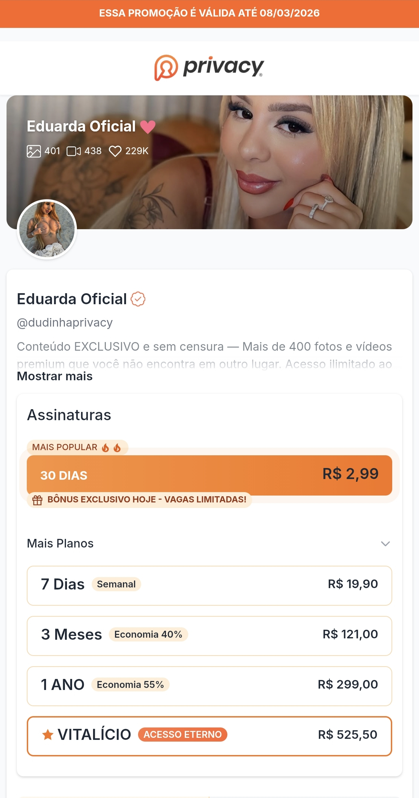

# 💳 Dudinha Ecompag

> **Checkout de pagamento PIX** integrado ao gateway Ecompag — página de planos, QR Code e confirmação via webhook.

---

## 🚀 Visão Geral

Landing de **pagamento/recebimento via PIX** com o gateway **Ecompag**: o
visitante escolhe um plano, gera o QR Code PIX, e o sistema confirma o
pagamento em tempo real (consulta + webhook). Inclui pixels de rastreamento,
scripts de desconto e automação de mensagens.

## ✨ Funcionalidades

| Módulo | Descrição |
|---|---|
| 💳 **Checkout PIX** | `checkout.html` + `api-pix.php` (QR Code) |
| 🔄 **Confirmação** | `check-payment.php` e `webhook.php` |
| 📦 **Planos** | Página de planos/assinaturas (`planos.php`) |
| 🎯 **Pixel/Tracking** | `pixel.js`, `conteudo.js` |
| 🤖 **Bots** | `bots.json` (automação) |
| 🔀 **Redirect** | `redirect.php` + páginas 403/404/500 |

## 🛠️ Stack

- **Backend:** PHP (`api-pix.php`, `vendor/`)
- **Frontend:** HTML/CSS/JS
- **Pagamento:** gateway Ecompag (PIX)

## ⚙️ Configuração

1. Apontar credenciais Ecompag em `config.php`.

---

## 🖼️ Prévia

## ⬇️ Download

📦 **[Release v1.0](https://github.com/VSFLima/dudinha-ecompag/releases/tag/v1.0)**

| Arquivo | Tamanho |
|---|---|
| [`dudinha.zip`](https://github.com/VSFLima/dudinha-ecompag/releases/download/v1.0/dudinha.zip) | 15 MB |

## 🙏 Créditos

- **Distribuição:** [@vsf_lima](https://t.me/vsf_lima) — Telegram
- **Sistema original:** jc_scripts / ecompag
